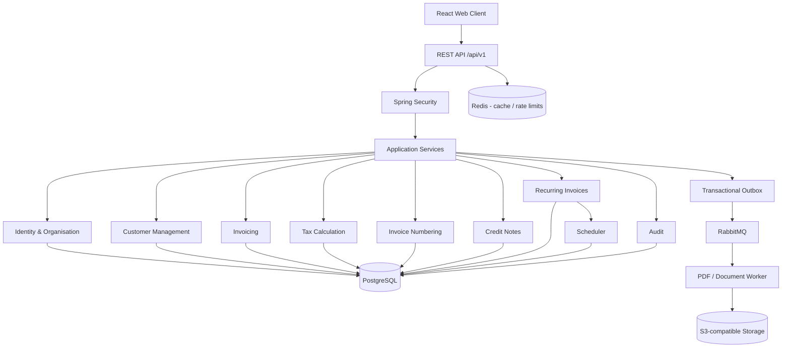
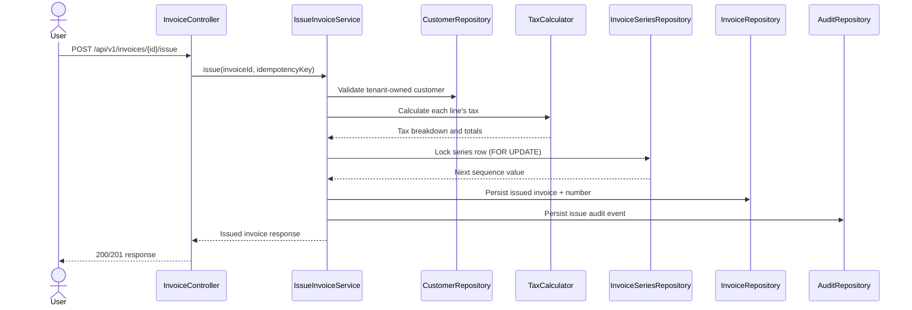

# PayTrack Backend Architecture

**Repository:** `Donel-KZ/paytrack`  
**Status:** Proposed implementation design  
**Branch:** `docs/backend-architecture`  
**Baseline:** PayTrack Phase 1 requirements, LV-JAVA-PAYTRACK-P1 v1.0  
**Related design:** [design.md](./design.md)

## 1. Architectural decision

Build PayTrack as a **modular monolith** using Java 21, Spring Boot 3, PostgreSQL, Spring Data JPA and Flyway.

A modular monolith is appropriate because invoice issuance must atomically coordinate validation, tax calculation, number allocation, status transition and audit persistence. Keeping these operations in one application and one relational database transaction is simpler and safer than introducing distributed transactions between microservices.

The application will be deployable as one backend service, but its code will be divided into business modules with explicit responsibilities and dependencies.

### 1.1 Architectural principles

1. Business rules live in the domain/application layer, not in controllers.
2. Controllers handle HTTP concerns and delegate to application services.
3. Every tenant-owned read and write is scoped to the authenticated organisation.
4. PostgreSQL is the source of truth for financial records and invoice numbering.
5. Money uses `BigDecimal` in Java and `NUMERIC` in PostgreSQL.
6. Issued invoices are immutable; corrections use credit notes.
7. External side effects (PDF storage, email, notifications) must not corrupt a committed financial transaction.
8. Schema changes are versioned through Flyway migrations.
9. Modules communicate through public application interfaces, not by reaching into one another's repositories.

## 2. High-level component architecture



**Important:** This is a logical component diagram, not a requirement to create one Spring Boot application per module. All modules initially run in the same deployable application.

## 3. Backend module boundaries

| Module | Owns | Main responsibilities |
|---|---|---|
| `identity` | Users, credentials, refresh tokens | Login, password hashing, refresh-token rotation and account status |
| `organisation` | Organisations, memberships, roles | Tenant context, membership management and role assignment |
| `customer` | Customers, addresses, payment terms | Customer validation, GSTIN/state data and tenant-scoped customer lifecycle |
| `invoicing` | Invoices and invoice lines | Draft creation/editing, issue orchestration, invoice queries and lifecycle rules |
| `tax` | Tax calculation policy/value objects | Per-line GST calculation, place-of-supply handling and rounding |
| `numbering` | Invoice series and counters | Transaction-safe number allocation per organisation, financial year and series |
| `creditnote` | Credit notes and credit-note lines | Corrections linked to issued invoices |
| `recurring` | Recurring invoice templates and run records | Scheduling, occurrence idempotency and draft/issue orchestration as approved |
| `document` | Document metadata and storage references | PDF generation, storage, checksum and signed download links |
| `audit` | Audit events | Append-only record of actor, action, target and change details |
| `shared` | Small cross-cutting primitives | Clock, error types, tenant identifier and common API response types only |

### 3.1 Dependency rules

- `invoicing` may call public interfaces from `tax`, `numbering` and `audit`.
- `creditnote` may reference issued invoices through an invoicing public interface.
- `recurring` creates invoices by calling the invoicing application interface; it must not insert invoice rows directly.
- `document` consumes a committed invoice snapshot/event and does not change financial invoice data.
- `identity` and `organisation` provide the authenticated tenant and membership context.
- `shared` must not become a dumping ground for business logic.
- Avoid circular module dependencies.

## 4. Proposed Java package structure

Use package-by-feature, with layers inside each module:

```text
src/main/java/com/paytrack/
├── PayTrackApplication.java
├── config/
│   ├── OpenApiConfig.java
│   ├── JacksonConfig.java
│   └── PersistenceConfig.java
├── security/
│   ├── SecurityConfig.java
│   ├── JwtAuthenticationFilter.java
│   ├── CurrentUser.java
│   └── TenantContext.java
├── identity/
│   ├── api/
│   ├── application/
│   ├── domain/
│   └── infrastructure/
├── organisation/
│   ├── api/
│   ├── application/
│   ├── domain/
│   └── infrastructure/
├── customer/
│   ├── api/
│   ├── application/
│   ├── domain/
│   └── infrastructure/
├── invoicing/
│   ├── api/
│   ├── application/
│   ├── domain/
│   └── infrastructure/
├── tax/
├── numbering/
├── creditnote/
├── recurring/
├── document/
├── audit/
└── shared/
    ├── error/
    ├── money/
    └── tenant/
```

Within a feature:
- `api`: REST controllers and request/response DTOs.
- `application`: use-case services and transaction orchestration.
- `domain`: entities, value objects, domain rules and repository interfaces where practical.
- `infrastructure`: Spring Data repositories, JPA mappings, storage/queue adapters and external integrations.

Do not expose JPA entities directly from REST controllers. Map entities to response DTOs.

## 5. Tenant isolation design

Tenant isolation is a security boundary, not merely a query convention.

### 5.1 Request context

1. Authenticate the request.
2. Resolve the user's active organisation membership.
3. Load the organisation ID and role from trusted server-side membership data.
4. Place the authenticated principal and tenant ID into a request-scoped security context.
5. Application services obtain the tenant ID from this trusted context.
6. Repositories include the tenant ID in every tenant-owned query.

Never trust an `organisationId` supplied in a request body, query parameter or URL as proof of tenant access.

### 5.2 Persistence rules

- Every tenant-owned table contains non-null `organisation_id`.
- Prefer composite tenant-aware foreign keys for relationships between tenant-owned rows. For example, a customer reference should be constrained by both `organisation_id` and customer ID.
- Repository methods should make tenant scope explicit, for example `findByIdAndOrganisationId(...)`.
- Avoid unrestricted `findById(...)` for tenant-owned entities in application use cases.
- Add indexes beginning with `organisation_id` for tenant-scoped access patterns.
- A resource belonging to another tenant must behave as not found (404), as required by NFR-01.
- Add integration tests that attempt cross-tenant access for each major aggregate.

A Hibernate filter or global ORM restriction may be considered as defence in depth, but it must not replace explicit tenant-aware repository methods and tests.


### 5.3 Multiple organisation memberships (ADR-001)

A single user account may belong to multiple organisations. The role is stored on the membership, never as a global user role.

```text
users (1) ─── (many) organisation_memberships (many) ─── (1) organisations
                         |
                         ├── role
                         └── status
```

The authenticated user selects an organisation for the current request. The client may send the selected organisation identifier, but the backend must verify an active `organisation_memberships` record for the authenticated user before establishing the tenant context. The role used for authorisation is read from that membership.

Deactivating one membership revokes access to that organisation only; other memberships remain unaffected. See [ADR-001](./adr/ADR-001-multi-organisation-membership.md).

## 6. Core invoice issuance workflow

Invoice issuance is the most important Phase 1 backend use case.



### 6.1 Transaction boundary

The issue use case should run in one database transaction:

1. Load the draft invoice using both invoice ID and authenticated organisation ID.
2. Check the user's permission to issue.
3. Check the idempotency key. If this operation was already completed, return the stored result.
4. Validate customer, line items, dates, currency and required tax inputs.
5. Calculate and persist the tax breakdown using the approved tax policy.
6. Lock the applicable invoice series row.
7. Allocate the next number.
8. Change the invoice status from `DRAFT` to `ISSUED`, set issue metadata and persist immutable financial snapshots.
9. Persist the audit event and an outbox event in the same transaction.
10. Commit.

If any database operation fails before commit, the transaction rolls back, including the sequence increment. Do not call the PDF storage provider while holding this transaction open.

### 6.2 After commit

A worker consumes the invoice-issued outbox event and generates/stores the PDF. It updates document-generation status separately. A PDF failure must be retried and surfaced operationally; it must not silently reverse or mutate the issued invoice.

The outbox is the recommended reliability pattern if RabbitMQ is used: write the event to PostgreSQL in the business transaction, then publish it asynchronously. A simple after-commit callback alone is not sufficient for guaranteed delivery if the process crashes after commit.

## 7. Data ownership and aggregate guidance

Treat an invoice as the aggregate root for its draft lines and issue lifecycle.

- Draft invoice lines can be added, changed or removed through invoice use cases.
- Issued invoice lines are immutable snapshots.
- The invoice stores its calculated subtotal, tax total and grand total, but these values are derived by the backend from validated lines.
- The invoice records the applied tax rates, tax type, place of supply and rounded component amounts so later configuration changes do not alter historical invoices.
- Credit notes reference the original issued invoice and preserve the correction history.
- Customer master-data changes must not rewrite the address, GSTIN or legal details already snapshotted on an issued invoice.

Do not add payments, allocations or reconciliation tables to the Phase 1 core until the mentor confirms the scope. The requirements position payment allocation as Phase 2 onward in the team responsibility breakdown.

## 8. API design conventions

- Base path: `/api/v1`.
- Use request DTOs with Bean Validation; never bind client JSON directly to JPA entities.
- Use consistent error responses with a stable machine-readable code, safe message, field errors and trace ID.
- Return 401 for unauthenticated requests, 403 for authenticated but forbidden actions, and 404 for resources outside the caller's tenant.
- Paginate list endpoints; define stable sorting.
- Use idempotency keys for operations that can create duplicate financial effects, especially invoice issue and later payment recording.
- Document endpoints, schemas, validation and error responses in OpenAPI at `/docs`.
- Use optimistic locking for concurrently editable drafts and return a conflict response for stale updates.

## 9. Transaction and concurrency strategy

| Problem | Strategy |
|---|---|
| Two users edit one draft | JPA `@Version` optimistic locking |
| Two requests issue invoices in same series | Lock series row with `SELECT ... FOR UPDATE` inside transaction |
| Client retries issue request | Persist and enforce idempotency key per tenant/operation |
| Duplicate invoice number | Database unique constraint on tenant + financial year + series + number |
| Duplicate recurring run | Unique occurrence key, such as template ID + scheduled period |
| Message publish fails after commit | Transactional outbox + retrying publisher |
| PDF worker processes event twice | Idempotent document generation keyed by invoice/document version |

## 10. Error handling and observability

Create a central exception handler using `@RestControllerAdvice`. Translate known failures into consistent API errors; do not expose stack traces, SQL, secrets or internal class names to clients.

Minimum operational endpoints:
- `/actuator/health` for liveness/health.
- Readiness checks for required dependencies, configured separately from liveness.
- Structured logs with request/trace ID and organisation ID where safe.
- Metrics for request latency, failures, queue depth, invoice issuance and PDF retries.

Never log passwords, access/refresh tokens, full payment credentials or unnecessary personal/customer data.

## 11. Testing strategy

| Test level | What to prove |
|---|---|
| Unit tests | Tax arithmetic, rounding, invoice state transitions, permission decisions and numbering formatting |
| Repository tests | Tenant-scoped queries, constraints and locking behavior |
| Integration tests (PostgreSQL Testcontainers) | Flyway migrations, tenant isolation, issue transaction rollback and concurrent numbering |
| API/security tests (MockMvc) | Authentication, role allowed/denied cases, validation and error contract |
| Concurrency tests | 20 simultaneous issue operations produce 20 consecutive unique committed numbers |
| Reliability tests | Idempotent retries, outbox redelivery and duplicate worker events |
| Coverage | At least 70% service coverage as required by NFR-10 |

Do not rely only on H2 for database behavior that must be verified on PostgreSQL, particularly row locks, constraints and transaction semantics.

## 12. Implementation sequence

Build the backend in vertical slices so every stage can be run and tested.

| Step | Deliverable | Exit condition |
|---|---|---|
| B0 | Spring Boot project skeleton, configuration, Docker Compose integration and health endpoint | App starts locally and connects to PostgreSQL |
| B1 | Flyway baseline, organisation, user and membership model | Migrations run cleanly; tenant context can be resolved |
| B2 | Authentication and role enforcement | Login works; allowed and denied role tests pass |
| B3 | Customer management | CRUD is tenant-scoped and GSTIN/state validation is tested |
| B4 | Draft invoice and invoice-line model | Draft can be created/read/updated with optimistic locking |
| B5 | Tax calculation service | Same-state, inter-state and mixed-rate hand calculations pass |
| B6 | Invoice numbering and issue transaction | Rollback/idempotency and 20-way concurrency tests pass |
| B7 | Credit notes and audit history | Corrections are linked; issued invoices remain immutable |
| B8 | PDF generation and document download | PDF is stored and retrieved using an expiring signed URL |
| B9 | Recurring invoice templates and scheduler | Occurrences are idempotent and failures are observable |

The team-specific FR-1.08 rule must be inserted into the appropriate module and tested as soon as it is obtained from the LogicVeda Team Workspace. It may change this sequence or the data model.

## 13. Decisions still requiring confirmation

1. The exact FR-1.08 client-specific rule.
2. Whether authentication is JWT access tokens plus rotating refresh tokens, and the expected token lifetimes.
3. Whether users can belong to multiple organisations and how active-tenant selection works.
4. Final tax rates, place-of-supply source, currency precision and rounding policy.
5. Whether invoice PDF generation is asynchronous for the initial release.
6. The approved Phase 1 boundary for recurring invoices: create draft automatically or issue automatically.
7. Which roles may void invoices and create credit notes, following mentor approval of the permission matrix.

---

**Implementation guardrail:** Do not start by generating every entity and controller. Establish the project skeleton, tenant/security boundary and database migrations first. The invoice issue workflow depends on those foundations.
